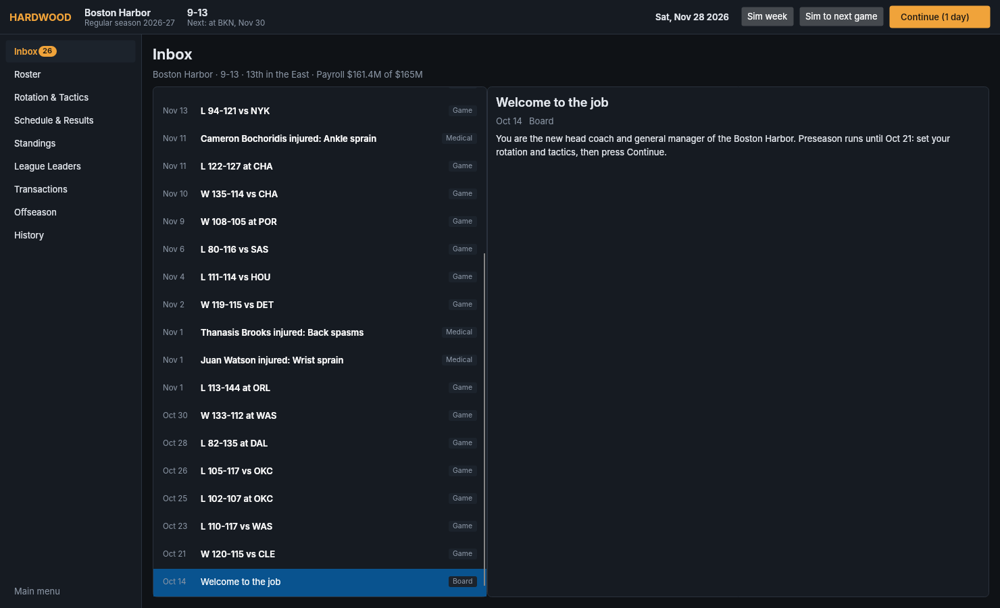
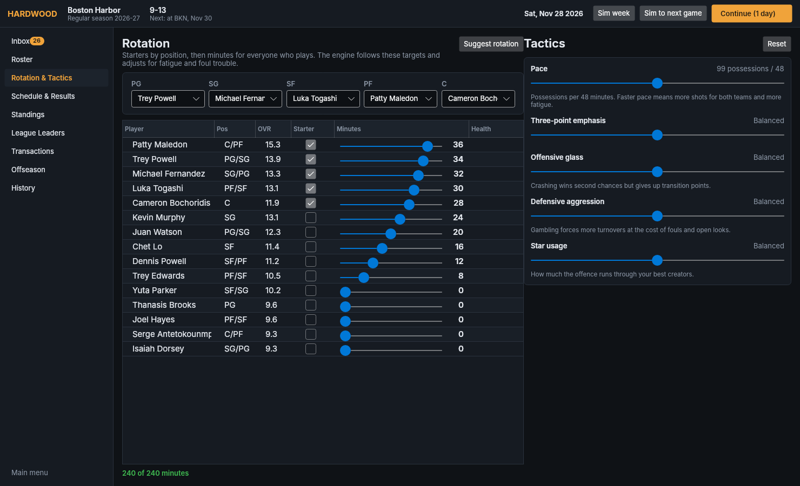
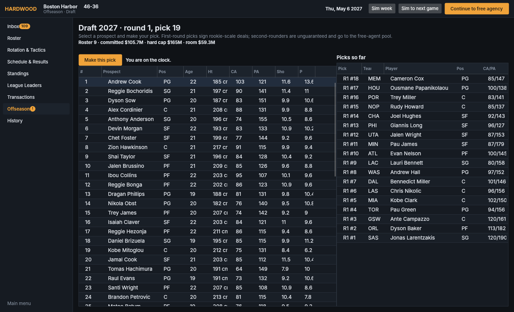

# Hardwood Manager

A basketball management simulation in the spirit of Football Manager: a living world of pro leagues, continental cups, FIBA windows, the World Cup and the Olympics, with drafts, salary caps, tactics and player development.

**Status:** phase 3 — a playable Windows desktop game. Pick a franchise, set your rotation and tactics, advance day by day through an 82-game season and the playoffs, then run your offseason: contract decisions, the lottery and draft, free agency and trades. Injuries, AI trades and a living 30-team league around you. Multi-season careers save to a single SQLite file.

## Locked decisions

| Decision | Choice |
| --- | --- |
| Stack | C# / .NET 8 headless core, Avalonia desktop UI (later), SQLite |
| First prototype | Match engine + one full 30-team season with playoffs |
| Reference league | Closed franchise (NABL-style: draft, cap, trades) |
| Ratings | 36 visible attributes on 1–20; Current/Potential Ability on 1–200 |
| Data | Procedurally generated default world; editable database and editor later |
| Persistence | One SQLite file per save |
| Cap model (reference league) | Hard cap, roster-minimum exception for minimum deals |
| Development | CA grows toward PA by age curve, minutes played and training quality; attributes anchored to CA |
| Offseason | Retirements, 2-round draft of generated rookies (2nd round unguaranteed), contract expiry, AI re-signing, free agency |
| Phase 3 | Avalonia desktop shell, day-by-day Continue, human rotation/tactics and offseason control, injuries, NBA-style lottery, trade AI by team direction, exact scouting for now, Windows x64 build |

## Play it

**Windows:** download the latest build from the repository's Releases page (or build it yourself below), run `HardwoodManager.exe`, choose a seed and a franchise, and press *Start career*. Saves go to `Documents\Hardwood Manager\career.hwsave` by default.

**From source (any OS):**

```bash
dotnet run --project src/Hardwood.Desktop
```

**Publish a Windows build:**

```bash
dotnet publish src/Hardwood.Desktop -c Release -r win-x64 --self-contained true -p:PublishSingleFile=true -p:IncludeNativeLibrariesForSelfExtract=true -o publish/win-x64
```

### Screens

Inbox · Roster (any team) · Player profile · Rotation & Tactics (starters, minutes targets, five sliders) · Schedule & Results with box scores and play-by-play · Standings · League Leaders · Transactions (trade builder with AI valuation, free agents, waivers) · Offseason (re-sign/release, draft room with lottery results, free agency) · History.

Top bar: *Continue* advances one day; *Sim to next game* and *Sim week* skip ahead. During the offseason, *Continue* moves to the next phase. The game saves after every day; the offseason is finished in one sitting (closing mid-offseason returns you to the Finals).

## Layout

```
src/Hardwood.Core/        headless simulation core (no UI dependencies)
  Model/                  Player, Team, League, Rules, attributes
  Generation/             PlayerGenerator, WorldGenerator, name pools
  Engine/                 GameSimulator (possession pipeline), EngineConfig (all tunables), BoxScore
  Season/                 ScheduleBuilder, Standings, SeasonSimulator, Postseason (day-by-day bracket), LeagueAverages,
                          PlayerSeasonStats, Development, ContractMarket, DraftLottery, Offseason (phased), Trades, GameSession, Career
  Engine/InjuryEngine     injury rolls and catalogue
  Persistence/            SaveFile (league tables) + SessionStore (calendar, results, box scores, inbox, bracket)
src/Hardwood.Desktop/     Avalonia desktop app (dark, data-first): ViewModels/ + Views/
src/Hardwood.Cli/         console runner (headless seasons, calibration)
tests/Hardwood.Tests/     xUnit tests, including a calibration check
```

## Run it

```bash
dotnet build
dotnet run --project src/Hardwood.Cli -- season --seed 2026      # full season, standings, playoffs, leaders, calibration table
dotnet run --project src/Hardwood.Cli -- game --seed 7 --log     # one game with box score and play log
dotnet run --project src/Hardwood.Cli -- roster --team BOS       # a generated roster
dotnet run --project src/Hardwood.Cli -- sim-years --years 20 --save dynasty.save   # 20 seasons: champions, MVPs, draft, league health
dotnet run --project src/Hardwood.Cli -- load --save dynasty.save                    # reopen a save and list its history
dotnet test
```

## How the match engine works

Each possession is resolved from the ten players on the floor:

1. Clock: seconds consumed are drawn around the two teams' pace settings (or a short transition possession after a live-ball turnover).
2. Turnover check from ball security vs. defensive pressure; live-ball turnovers credit a steal and start a transition possession.
3. Non-shooting foul check; bonus free throws once a team is in the penalty.
4. Shooter chosen by usage (shot creation, shooting, tendencies, the team's star-usage slider); shot zone chosen from the shooter's tendencies and the team's three-point emphasis.
5. Make probability: `σ(zoneBase + β·skill − β·contest − β·fatigue + home + form)`, where contest comes from the matched defender, help defense and wingspan.
6. Shooting fouls, blocks, free throws, rebounds (offensive rebounds continue the possession), assists.
7. Fatigue drains on the floor and recovers on the bench; substitutions happen at dead balls on energy and foul trouble.

Every number is in `EngineConfig`. The `season` command prints league averages against real-world targets so each change can be checked.

## Season-to-season loop

`Career.PlaySeason` builds the schedule, plays the season, aggregates stats, then runs `Offseason`: progression and aging for every player (minutes played matter), retirements, contract tick-down, a two-round draft of generated prospects, re-signing under the hard cap, free agency, roster and cap compliance, and the season counter. Each season is saved to the SQLite file. A 20-season run takes about 75 seconds and holds a stable steady state: league-average CA about 112, average age about 25.5 with a realistic veteran tail, payrolls at the cap.

## Design document

The full game design document lives in the project's Claude doc (Hardwood Manager — Game Design Document).

## Screenshots




